# Systems Application Engineering Lab

A small personal homelab I built to practise running, monitoring and troubleshooting the kind of middleware a systems application engineer supports: a message broker, a search/logging stack, and metrics with alerting. I deliberately broke things, watched the alerts fire, fixed them, and wrote runbooks from what I learned.

> **Lab only.** Everything here runs on a single VM with throwaway credentials. Security is disabled on Elasticsearch for convenience; that must never be done in production.

## What I built

| Area | What I did |
|---|---|
| Virtualisation | Cloned and sized an Ubuntu Server 24.04 VM on a 3-node Proxmox VE 9.1 cluster; extended the LVM volume to use the full disk (`lvextend -r`). |
| Containers | Docker 29 + Compose v5 on the VM. |
| Messaging | RabbitMQ 4.4 with the management UI. Python (pika) producers/consumers. |
| Search / logs | Elasticsearch 8.15.3 (single node) and Kibana 8.15.3. |
| Monitoring | Existing Prometheus Operator stack (kube-prometheus-stack) on a K3s cluster scrapes the VM via static Endpoints/Service/ServiceMonitor. RabbitMQ's built-in Prometheus plugin and the elasticsearch-exporter provide the metrics. |
| Alerting | Two Grafana-managed alert rules (queue backlog, Elasticsearch cluster health) that I triggered, saw fire, and saw resolve. |
| Runbooks | Two: [queue backing up](docs/runbook-queue-backing-up.md) and [Elasticsearch yellow/red](docs/runbook-elasticsearch-yellow-red.md). |

## Architecture

```
            Proxmox VE cluster (3 nodes)
   +---------------------------------------------+
   |  lab VM (Ubuntu 24.04, Docker)              |
   |   RabbitMQ :5672 / :15672 UI / :15692 metrics|
   |   Elasticsearch :9200   Kibana :5601        |
   |   elasticsearch-exporter :9114              |
   +----------------------+----------------------+
                          | scrape (15s)
   +----------------------v----------------------+
   |  K3s: Prometheus Operator (monitoring ns)   |
   |   ServiceMonitors -> Prometheus -> Grafana  |
   |                          alert rules        |
   +---------------------------------------------+
```

## Scenarios I ran

1. **Queue piles up with no consumers.** Published 1,000+ messages to a durable `orders` queue with no consumer. Management UI showed ~1,005 ready, 0 consumers. Started a consumer and watched it drain. ([screenshots 01-04](docs/images/README.md))
2. **Stuck unacked messages.** A consumer that receives but never acks held 10 messages unacked (prefetch 10). Stopping it returned them to *ready*. ([05-06](docs/images/README.md))
3. **Poison messages and a dead-letter queue.** Rejected messages with `requeue=false` were routed through a dead-letter exchange to `dead_letters`; inspected the `x-death` header. ([07-08](docs/images/README.md))
4. **Elasticsearch goes yellow.** An index with 1 replica on a single node leaves the replica shard unassigned. `_cluster/allocation/explain` showed the `same_shard` decider. Fixed by setting replicas to 0 (fine for a lab, not a fix for production). ([09-11](docs/images/README.md))
5. **Kibana.** Created a data view and searched documents in Discover with KQL. ([12-13](docs/images/README.md))
6. **Metrics and alerts.** Verified Prometheus targets up, queried both sources in Grafana Explore, built the two alert rules, and triggered and resolved each. ([14-23](docs/images/README.md))

## Screenshots

Key moments from the lab. The full set is in [docs/images](docs/images/README.md).

**Queue piled up with no consumers (1,005 ready, 0 consumers)**
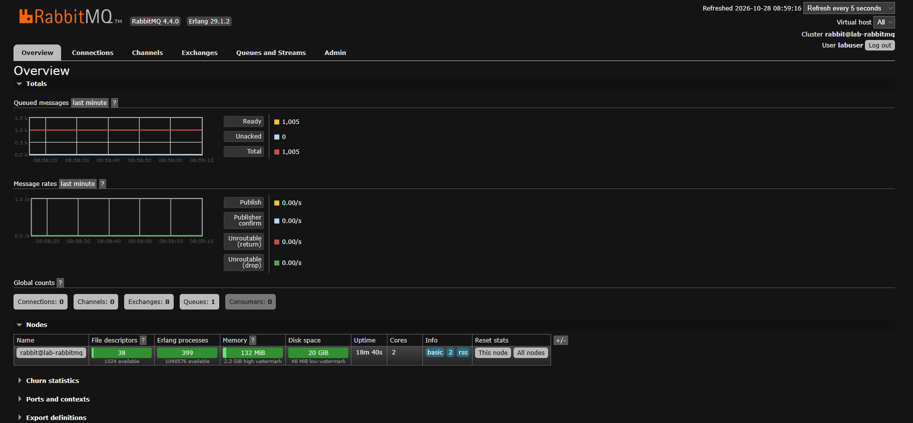

**Consumer started, queue draining**
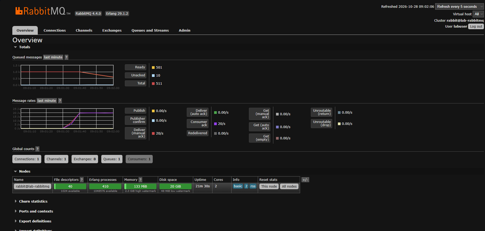

**Messages stuck unacked**
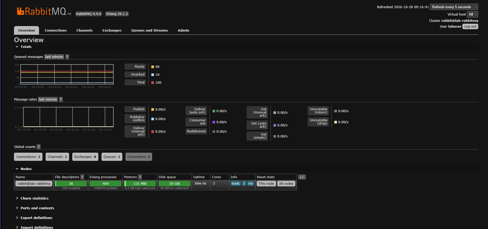

**Dead-lettered message and its `x-death` header**
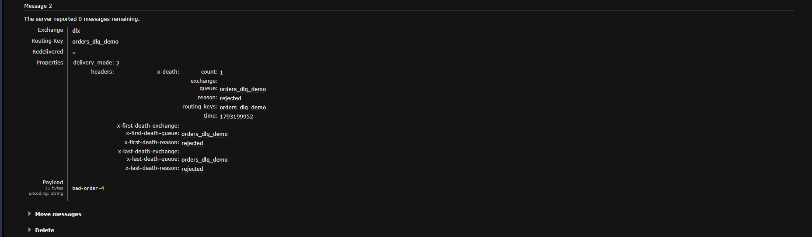

**Elasticsearch yellow, then the allocation explain**
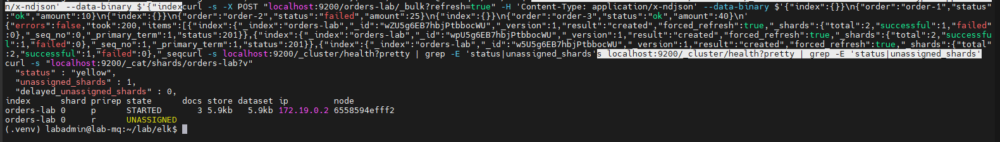
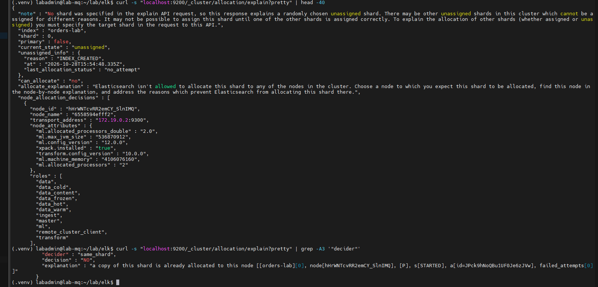

**Back to green after setting replicas to 0**
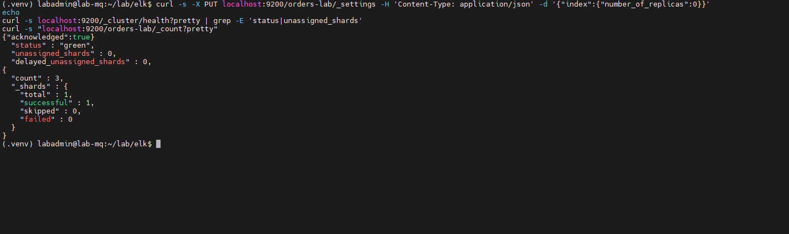

**Prometheus scraping the lab VM**
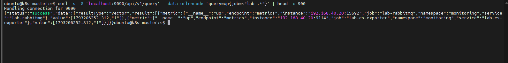

**Queue alert firing, then resolved**
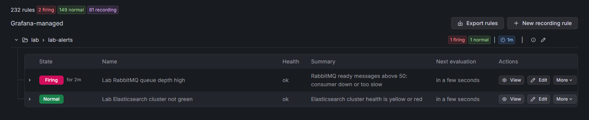
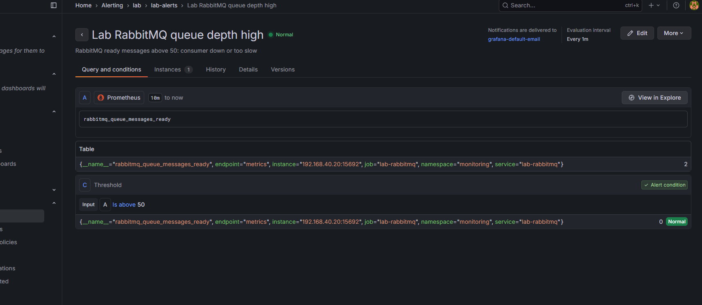

**Elasticsearch alert firing, then resolved**
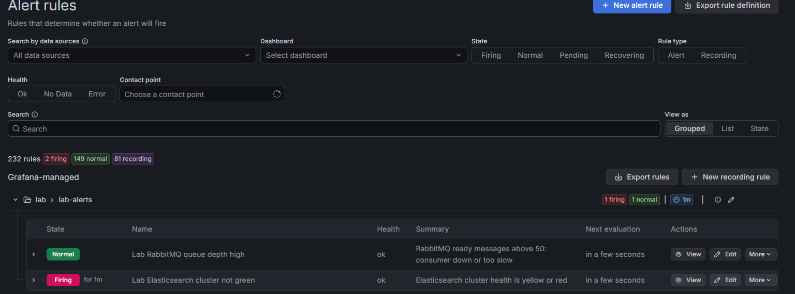
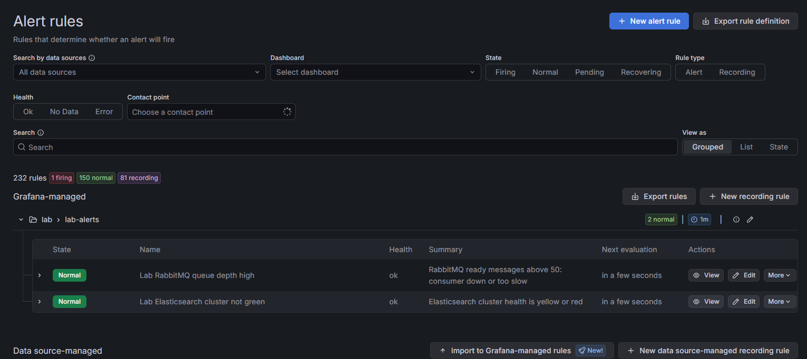

## Run it yourself

Prerequisites: a Linux VM with Docker and Compose, Python 3.

```bash
# RabbitMQ
cd rabbitmq
cp .env.example .env        # set a lab-only password
set -a; . ./.env; set +a   # loads RABBITMQ_USER / RABBITMQ_PASS into your shell
docker compose up -d
pip install -r requirements.txt
python producer.py 1000
python consumer.py

# Elasticsearch + Kibana + exporter
cd ../elk
docker compose up -d
./load-sample-data.sh
curl -s localhost:9200/_cluster/health?pretty
```

To have an existing Prometheus Operator scrape the VM, edit `LAB_VM_IP` in [`k8s/lab-scrape.yaml`](k8s/lab-scrape.yaml) and `kubectl apply -f` it.

Useful checks:

```bash
docker exec lab-rabbitmq rabbitmqctl list_queues name messages_ready messages_unacknowledged consumers
curl -s "localhost:9200/_cluster/allocation/explain?pretty"
curl -s -G 'localhost:9090/api/v1/query' --data-urlencode 'query=up{job=~"lab-.*"}'
```

## What I got wrong along the way

- Pasting into the Proxmox web console didn't work, so I switched to SSH.
- SSH timed out even though ping worked: `openssh-server` wasn't installed.
- The installer's default LVM layout used only half the disk; fixed with `lvextend -r -l +100%FREE`.
- A Prometheus API query failed from shell quoting; fixed with `curl -G --data-urlencode`.
- The Grafana alert default threshold (0) would have fired on the 2 messages sitting in the DLQ; I set it to 50.
- One alert editor defaulted to "IS ABOVE"; the no-data rule needed "IS BELOW".

Full detail in [docs/lab-notes.md](docs/lab-notes.md).

## Honest limits

- Scale is tiny: ~1,000 messages, a single-node Elasticsearch, one VM.
- Elasticsearch security is off (lab only). Production needs TLS, authentication and roles.
- Single-node ES with replicas=0 has no redundancy.
- RabbitMQ is a single node, no clustering or quorum-queue tuning.

## Not built

I did **not** build or run these, so nothing here claims experience with them: Camunda, Kafka, NiFi, Active Directory/LDAP. They are next on my learning list.

## Layout

```
rabbitmq/   compose, pika scripts
elk/        compose (ES, Kibana, exporter), sample data script
k8s/        scrape config for Prometheus Operator
docs/       runbooks, lab notes, screenshots
```
